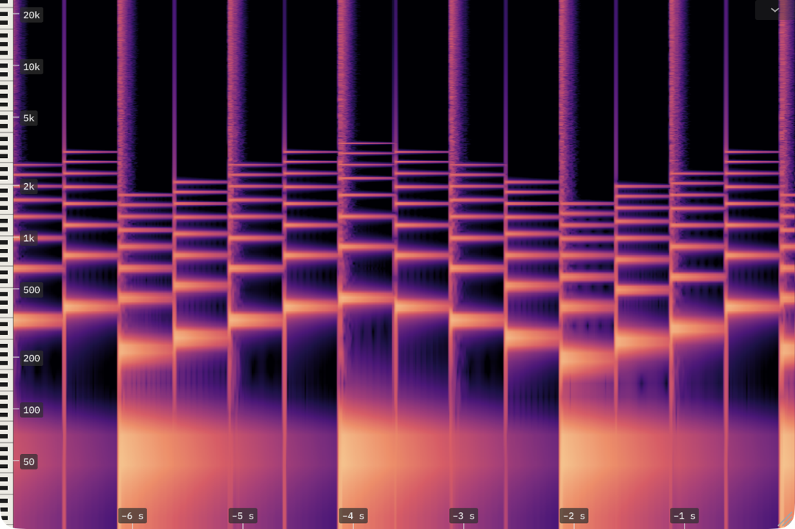

# char-spectrogram

A scrolling spectrogram plug-in, drawn on the GPU with WebGPU/Dawn. It is built on
[char-clap-template](https://github.com/charCulbert/char-clap-template)'s
libraries, and its interface is made only of chardraw's parts.



The plugin passes audio through and shows how its spectrum changes over time,
with an FFT or a constant-Q transform. The settings are in the drawer at the
top right; right-click the plot for the overlays, colours, scale and Pause. Hold
a key of the piano strip, or the plot with Click tone on, to hear its pitch.

## Download

| Platform | Formats | Download |
|---|---|---|
| macOS | CLAP, VST3, AU | [char-spectrogram-macOS.zip](https://github.com/charCulbert/char-spectrogram/releases/latest/download/char-spectrogram-macOS.zip) |
| Windows | CLAP, VST3 | [char-spectrogram-Windows.zip](https://github.com/charCulbert/char-spectrogram/releases/latest/download/char-spectrogram-Windows.zip) |
| Linux | CLAP, VST3 | [char-spectrogram-Linux.zip](https://github.com/charCulbert/char-spectrogram/releases/latest/download/char-spectrogram-Linux.zip) |
| Browser hosts | WCLAP | [char-spectrogram.wclap.tar.gz](https://github.com/charCulbert/char-spectrogram/releases/latest/download/char-spectrogram.wclap.tar.gz) |

All releases are on the [releases page](https://github.com/charCulbert/char-spectrogram/releases).

## Settings

Saved with the plugin's state; not automatable. The CQT runs at 44.1 to 96 kHz; at
other rates the plugin shows the FFT.

| Setting | Values | Default |
|---|---|---|
| Transform | FFT or CQT | FFT |
| FFT size | 256 to 16384, powers of two | 2048 |
| Hop | 128 (or a 480th of the sample rate) to the FFT size | 512 |
| Window | Rectangular, Hann, Hamming, Blackman | Hann |
| Channel | Mix, Left, Right | Mix |
| CQT bands per octave | 12, 24, 36 | 24 |
| CQT range | lower 27.5 to 220 Hz, upper 1 kHz to 0.4 × sample rate | 55 Hz to 16 kHz |
| CQT update rate | 15, 30, 60 a second | 30 |
| CQT reading | Mean, Peak, Centre | Mean |
| A4 tuning | 400 to 480 Hz | 440 Hz |
| Frequency range | lower 0 to 500 Hz, upper 100 Hz to Nyquist | 20 Hz to 24 kHz |
| Level range | floor −160 to −20 dB, ceiling −20 to 12 dB, 10 dB apart at least | −100 to 0 dB |
| Scale | Linear, Log | Log |
| Colours | Magma, Viridis, Inferno, Plasma, Cividis, Turbo, Grayscale | Magma |
| Scroll rate | 25 to 200 points a second | 100 |
| Piano strip, snap, readout, labels, click tone | On, Off | On |

## Build

```sh
git clone https://github.com/charCulbert/char-spectrogram.git
cd char-spectrogram
cmake -B build
cmake --build build
```

That builds CLAP, VST3, AU (macOS) and a standalone app into `build/`. It needs
CMake 3.28 or later and a C++20 compiler; on Linux also `libasound2-dev`,
`libx11-dev` and `libxrandr-dev`.

CMake downloads the template's libraries (`libs/`) at the version pinned in
`CMakeLists.txt` (`GIT_TAG`), and they pin everything else they download. To
build against a local checkout of the template instead, add
`-DFETCHCONTENT_SOURCE_DIR_CLAP_TEMPLATE=<path to char-clap-template>` when
configuring.

WCLAP, for browser hosts, needs the [WASI SDK](https://github.com/WebAssembly/wasi-sdk/releases)
and [Emscripten](https://emscripten.org) (`emcmake` on your `PATH`):

```sh
cmake -B build-wclap -DCMAKE_TOOLCHAIN_FILE=<wasi-sdk>/share/cmake/wasi-sdk-p1.cmake
cmake --build build-wclap        # makes build-wclap/CharSpectrogram.wclap.tar.gz
```

To run the tests after building: `ctest --test-dir build`.
